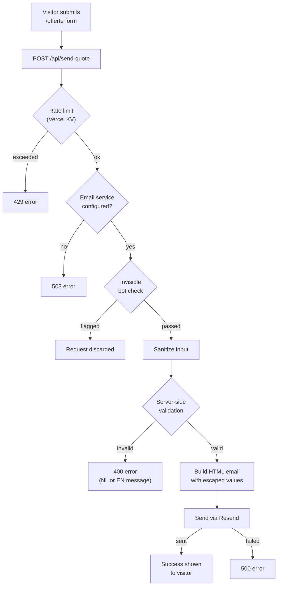

# Kubusklus website

Bilingual (Dutch/English) marketing site with a quote request form for an Amsterdam renovation company, built with Next.js.

**Live at https://kubusklus.nl**

## About

This is the website of Kubus Klussenbedrijf (public name: Kubusklus), a renovation and finishing company in Amsterdam. It was built by Göktuğ Yıldırım as freelance client work under Bouwly Web Studio. The repository is the production code of the live site.

The site presents the company's services and projects and lets visitors request a quote ("offerte") online.

## Pages

Every page exists under `/nl` and `/en`. Dutch is the default language.

| Route | Content |
| --- | --- |
| `/` | Home: hero, trust bar, services overview, project preview, how we work, call to action, FAQ |
| `/diensten` | Services |
| `/projecten` | Projects (photo portfolio) |
| `/werkwijze` | How the company works |
| `/over-ons` | About |
| `/faq` | Frequently asked questions |
| `/contact` | Contact |
| `/offerte` | Quote request form |
| `/privacy` | Privacy statement |

All pages share an emergency-contact bar, a navbar with a language switcher, a footer and a WhatsApp button. The quote form offers ten service categories (for example facades, painting, tiles, parquet and partitions).

## How the quote form works

The form on `/offerte` posts to a single API route, `src/app/api/send-quote/route.ts`. On the current `master` branch the request path is:

1. The browser sends the form data and the active language as JSON to `/api/send-quote`.
2. The server applies per-client rate limiting, backed by Vercel KV.
3. The server checks that e-mail sending is configured.
4. An invisible bot check discards automated submissions.
5. Every field is sanitized: HTML tags are stripped and lengths are capped.
6. The server validates the fields: name, e-mail format (including header-injection characters), optional phone number, a service from a fixed allow-list, description length and an optional start date that must not be in the past. Error messages are returned in the visitor's language.
7. A notification e-mail is built with every user-supplied value HTML-escaped, then sent through Resend from the company's verified domain. The reply-to address is the visitor's, so staff can answer directly.
8. The browser shows a success or error state. A rate-limited visitor gets a distinct message.



Protections in place: server-side validation and sanitization, rate limiting, an invisible bot check, and HTML escaping of all user input in the outgoing e-mail. Response headers also set a Content Security Policy, HSTS, frame denial and related headers (see `next.config.ts`). Details of the thresholds are intentionally not documented here.

## Internationalization

- Routing and messages use `next-intl`. Locales (`nl`, `en`) are defined in `src/i18n/routing.ts`; Dutch is the default.
- All pages live under `src/app/[locale]/`. A proxy (`src/proxy.ts`) handles locale negotiation and redirects, and skips API routes and static files.
- Copy is stored in one JSON file per language: `src/i18n/messages/nl.json` and `en.json`.
- Unknown paths under a locale render a localized not-found page.
- A small client component (`TranslationGuard`) keeps the form from crashing when a visitor uses the browser's automatic page translation.

## SEO and structured data

- Per-locale canonical URLs and `hreflang` alternates (`nl`, `en`, `x-default`), plus Open Graph metadata.
- `sitemap.xml` generated in `src/app/sitemap.ts`, listing every page in both languages; `robots.txt` points to it.
- JSON-LD `HomeAndConstructionBusiness` markup in the locale layout (business details, opening hours, service area).
- Permanent redirects for two legacy `.php` URLs from the previous site.
- Project images are served as WebP; `scripts/convert-images-to-webp.mjs` converts source JPEGs using `sharp`.

## Deployment

The site is set up for Vercel: the rate limiter uses Vercel KV, and the repository contains a `.vercelignore` and ignores `.vercel`. `npm run build` produces the production build and `npm run start` serves it.

## Tech stack

Versions are taken from `package.json`.

| Area | Technology |
| --- | --- |
| Framework | Next.js 16.2.1 (App Router) |
| UI | React 19.2.4, Tailwind CSS ^4 |
| Language | TypeScript ^5 |
| i18n | next-intl ^4.8.3 |
| E-mail | Resend ^6.10.0 |
| Rate limiting store | @vercel/kv ^3.0.0 |
| Images (script) | sharp ^0.34.5 |
| Linting | ESLint ^9 with eslint-config-next 16.2.1 |

## Running locally

```bash
npm install
npm run dev      # development server at http://localhost:3000
npm run lint     # lint
npm run build    # production build
npm run start    # serve the production build
```

Create a `.env.local` file (git-ignored) with these variable names:

| Variable | Purpose |
| --- | --- |
| `RESEND_API_KEY` | Required to send quote e-mails. Without it the API route returns an error. |
| `OWNER_EMAIL` | Optional. Recipient of quote e-mails; the code has a default. |
| `KV_REST_API_URL`, `KV_REST_API_TOKEN` | Used by `@vercel/kv` for rate limiting. These names come from that library's convention rather than from this repository's code. |

Never commit real values.

## Credits

Built by Göktuğ Yıldırım for Kubus Klussenbedrijf, under Bouwly Web Studio.

## License

This repository does not include a license file.
